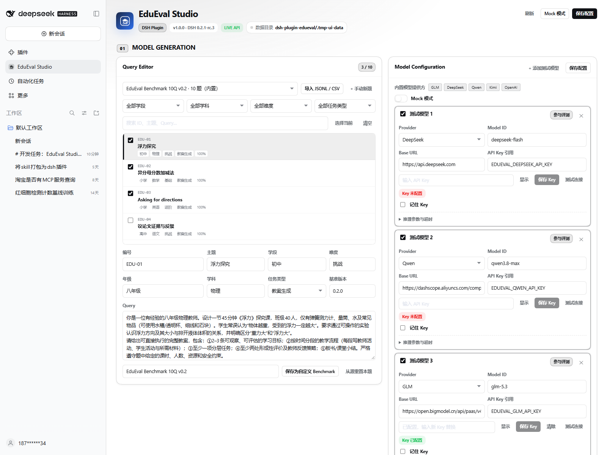
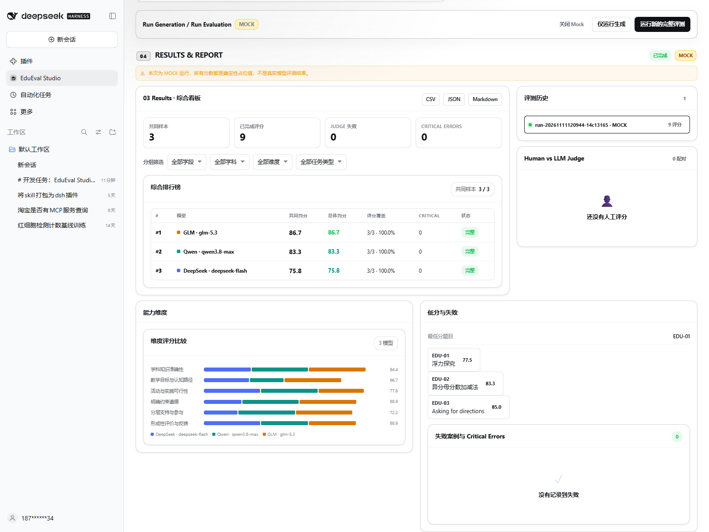
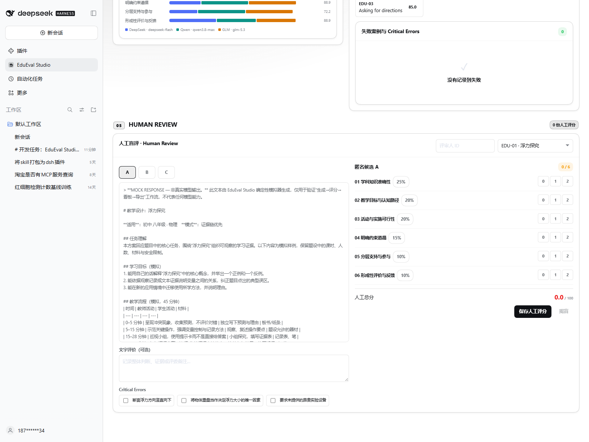

# EduEval Studio — DSH-native evaluation workbench

**EduEval Studio** is a native DeepSeek Harness (DSH) plugin for reproducible multi-model evaluation. It adds a real workbench page to the DSH Web UI: import a benchmark, select cases, configure several models, edit per-case rubrics, run generation and an independent LLM Judge, perform blind human review, inspect dashboards, and export reports.

This is not a standalone web app or an iframe. The package is a Cordis bundle with a Host half and a browser Client half, loaded by DSH's own profile, loader, slot, credential, and authenticated transport systems.

Design notes and development history: [docs/design-and-development.zh.md](docs/design-and-development.zh.md) (Chinese).



> **Verification status:** the UI and full mock workflow were exercised in a real DSH Web UI at `0.2.1-rc.3`. Real provider calls were also exercised, including GLM connectivity, a full lesson-plan generation, and real DeepSeek/Qwen/GLM run records. Provider balance, rate-limit, and long-output timeout errors are surfaced as-is. Mock output is always labeled `MOCK` and is not a real benchmark conclusion.

| Dashboard | Human blind review |
|---|---|
|  |  |

## Verified environment

| Item | Value |
|---|---|
| DSH | `0.2.1-rc.3` (Desktop distribution; the running app does not expose a Git commit) |
| DSH Host runtime | Node `24.21.0` (bundled runtime); development shell Node `24.14.0` |
| Profile used for installation | `desktop` (`$DSH_HOME/profiles/desktop`) |
| Profile used for live UI verification | isolated `edueval-verify` web profile, same package, port `7461` |
| Browser verification | installed Google Chrome via Playwright, desktop viewport 1600×1200 |
| Benchmark | `EduEval Benchmark 10Q v0.2` — 10 cases, 5 lesson plans + 5 slide outlines |
| Tests | 13 automated tests, all passing |

The installed plugin is a linked package at:

```text
$DSH_HOME/profiles/desktop/node_modules/dsh-plugin-edueval
  -> <workspace>/dsh-plugin-edueval
```

The Desktop app keeps the active agent session alive, so it was not terminated and restarted during this verification. The profile manifest and bundle list contain the plugin. Restart DeepSeek Harness (or reload the profile in a fresh app process) to guarantee the Host half is loaded; the same package was booted and verified in the isolated web profile.

## Install

### Requirements

- DSH `>=0.2.1-rc.3 <0.3.0` with the Web GUI (`@deepseek-ai/dsh-web-app`).
- A DSH profile. The examples use `desktop` and `web`.
- End users do **not** need a separate Node.js/npm install; the DSH CLI installs the local tarball. Node.js 22+ is only needed for development, tests, and repacking.
- The plugin has **no runtime npm dependencies** and no build step.

### For someone else: install from the shared tarball (recommended)

Send the recipient only `dsh-plugin-edueval-1.0.0.tgz`. They do not need this source checkout.

**Windows PowerShell:**

```powershell
dsh plugin --profile desktop add "C:\Users\<name>\Downloads\dsh-plugin-edueval-1.0.0.tgz"
```

**macOS / Linux:**

```bash
dsh plugin --profile desktop add "$HOME/Downloads/dsh-plugin-edueval-1.0.0.tgz"
```

If `dsh` is not on `PATH`, use the CLI shipped with DSH, for example on Windows:

```powershell
& "$env:LOCALAPPDATA\Programs\DeepSeek Harness\resources\runtime\cli\bin\dsh.cmd" plugin --profile desktop add "C:\path\to\dsh-plugin-edueval-1.0.0.tgz"
```

Then fully quit and restart DeepSeek Harness. Open **EduEval Studio** from the left sidebar.

Verify the installation:

```powershell
dsh plugin --profile desktop list dsh-plugin-edueval
```

### From a directory checkout (development only)

```powershell
dsh plugin --profile desktop add "C:\path\to\dsh-plugin-edueval"
```

Then restart DeepSeek Harness. Open the sidebar entry **EduEval Studio**.

### Web profile

```bash
dsh plugin --profile web add "/path/to/dsh-plugin-edueval-1.0.0.tgz"
dsh --profile web
```

Open the printed authenticated URL, then choose **EduEval Studio** from the sidebar.

The package declares both `dsh.bundle.patch` and `dsh.client`, so `dsh plugin add` adds it as a profile bundle instead of a plain dependency.

### Upgrade

```bash
dsh plugin --profile desktop add "/path/to/dsh-plugin-edueval-1.0.0.tgz"
```

Restart the app. Runs, custom benchmarks, and configuration under the data directory survive upgrades.

### Sharing checklist

- Share the `.tgz`, not `$DSH_HOME`, a profile directory, or `.credentials.yaml`.
- Never include API keys. Every recipient enters their own keys in **Model Configuration** and clicks **Save Key**.
- Each recipient needs their own model-provider access/balance; the plugin itself contains no credits.
- Without API keys, the recipient can still use **Mock 模式** to verify the workflow.
- Keep the DSH version compatible (`0.2.1-rc.3` or later `0.2.x`).

### Uninstall

```powershell
dsh plugin --profile desktop remove dsh-plugin-edueval
```

Uninstalling removes the bundle/layer but **does not delete evaluation data**. To erase everything explicitly:

```powershell
# Windows default
Remove-Item -Recurse -Force "$env:USERPROFILE\.dsh\edueval"

# POSIX default
rm -rf "${DSH_HOME:-$HOME/.dsh}/edueval"
```

If `EDUEVAL_DATA_DIR` is set, delete that directory instead.

## What it does

- **Native UI:** a `main` panel keyed `edueval` and a sidebar row in `sidebar.panellist`; no iframe and no second HTML application.
- **Query and benchmark workflow:** manual query authoring, per-case editing, filtering by stage/subject/difficulty/task type, JSONL/CSV import, custom benchmark save, and subset selection.
- **Three model-test slots by default:** each card is labeled **Test model 1 / 2 / 3**. A provider dropdown (GLM, DeepSeek, Qwen, Kimi, OpenAI, Custom) auto-fills Base URL, Model ID, and key reference; every field remains editable. Additional test-model slots can be added.
- **Official provider presets checked on 2026-11-11:** GLM `glm-5.3` via `https://open.bigmodel.cn/api/paas/v4`; DeepSeek `deepseek-flash` via `https://api.deepseek.com`; Qwen `qwen3.8-max` via DashScope compatible mode; Kimi `kimi-k3.1-pro` via `https://api.moonshot.cn/v1`; OpenAI `gpt-4o-mini`.
- **Maximum output tokens are not capped:** the default is `0`, which omits `max_tokens` and lets the provider use its own limit. An explicit positive value is sent unchanged; there is no upper limit in the schema or UI.
- **Independent Judge:** a separate model, Base URL, key reference, temperature, output-token setting, and fixed scoring protocol.
- **Per-case rubrics:** six criteria in the shipped benchmark, editable names, weights, full-score requirements, and Critical Errors. Weights must total 100%.
- **0/1/2 scoring:** every criterion is scored 0, 1, or 2. The Host recomputes the total as `Σ(weight × score / 2)` and returns a 0–100 score.
- **Batch runs:** generation-only or full generation+judge runs; progress for generation and judging; per-task failures; retry of failed tasks; cancel/resume.
- **Human blind review:** deterministic anonymous A/B/C ordering per case, hidden model identity before reveal, per-criterion human scores, comments, and reveal after saving.
- **Results:** leaderboard on the common successful sample, coverage, dimension comparison, group filters, low-scoring cases, failures/critical errors, human-vs-judge agreement (MAE, exact agreement, Spearman when n ≥ 5).
- **Export:** CSV, JSON, and Markdown.
- **Persistence:** run history survives page reloads, sessions, and Host restarts.

## Architecture

```text
DSH profile (desktop / web)
  └─ dsh-plugin-edueval bundle
       ├─ Host entry (index.js -> src/host)
       │    ├─ authenticated exact Fetch routes under /api/edueval
       │    ├─ benchmark import / validation
       │    ├─ OpenAI-compatible model adapter
       │    ├─ LLM Judge + strict output validation
       │    ├─ deterministic task runner (concurrency/retry/cancel)
       │    ├─ scoring, analytics, blind mapping, export
       │    └─ atomic JSON persistence under $DSH_HOME/edueval
       └─ Client entry (client.js)
            ├─ lazy-CJS DSH module factory
            ├─ React component registered in `main`
            └─ icon row registered in `sidebar.panellist`
```

### Why this integration shape

DSH exposes slots rather than arbitrary routes or an iframe page. The shipped UI's sidebar has a `sidebar.panellist` list and the main column is a keyed `main` slot. EduEval registers one icon in the former and one page component under key `edueval` in the latter, which is exactly how the installed DSH plugin market adds its own page. The result is a true in-app page that inherits DSH layout, theme tokens, locale, and navigation.

Host/Client communication uses the official authenticated Fetch-route registry (`ctx.connection.fetch.register`). Every route is served under `/api/edueval/...`, passes DSH's Host/Origin and browser-cookie admission checks, and only accepts the owner principal. No API key is ever returned to the browser.

### Why model calls are implemented as a separate adapter

DSH's model service is designed to drive Agent sessions. An Agent session may include tools, memory, system context, compaction, and dynamic behavior that would contaminate a benchmark. EduEval therefore uses a small OpenAI-compatible `/chat/completions` adapter:

- fixed generation system prompt;
- no tools, no Agent loop, no session history;
- per-request temperature / output-token / timeout snapshot;
- explicit provider/model/Base-URL, recorded in the run.

DSH credential management is still reused: keys can be resolved by reference from `ctx.credentials`, and the “Remember key in DSH Credential Store” option writes via `ctx.credentials.set()`.

## Using the workbench

### 1. Import or author queries

- The built-in benchmark is loaded automatically (10 cases).
- Use **Import JSONL / CSV** for batch import.
- Use **+ New query** to author a case.
- Filter by stage, subject, difficulty, task type, or text search.
- Check the cases to include in the run.
- Edit the Query and metadata inline.
- **Save as custom benchmark** stores the current case set under the plugin data directory.

Each case and its rubric are bound by a single `id` (`case_id`). A run snapshots the edited query and rubric; it does not mutate benchmark source files.

#### JSONL schema

One JSON object per line:

```json
{
  "id": "EDU-L01",
  "benchmark_version": "0.2.0",
  "task_type": "lesson_plan",
  "stage": "初中",
  "grade": "八年级",
  "subject": "物理",
  "topic": "浮力探究",
  "difficulty": "挑战",
  "tags": [],
  "query": "……",
  "rubric": [
    {
      "criterion_id": "knowledge",
      "name": "学科知识准确性",
      "weight": 25,
      "full_score_requirements": "正确说明……"
    }
  ],
  "critical_errors": ["断言浮力方向竖直向下"]
}
```

Rules:

- `id` is required, unique within the benchmark, and limited to `A-Z a-z 0-9 . : _ -`.
- `rubric` has 1–20 criteria; each `criterion_id` is unique and each `weight` is positive.
- Weights must total **100** (tolerance 0.01).
- `full_score_requirements` is required.
- `critical_errors` is a string array.

#### CSV schema

Header row required. Supported columns:

```text
id, query, rubric_json, critical_errors_json, stage, subject, grade,
difficulty, task_type, topic, tags, benchmark_version
```

- `rubric_json` is a JSON array; if omitted, a generic editable six-dimension rubric is used.
- `critical_errors_json` can be a JSON array or a `|`-separated string.
- `tags` is `|`-separated.
- Quoted cells, embedded commas/newlines, escaped quotes, CRLF, and UTF-8 BOM are handled.

The shipped file is `data/benchmark_v0.2.jsonl`, copied byte-for-byte from the supplied `benchmark_10q_v0.2.jsonl`. The supplied judge/blind-review protocol is included as `data/judge_prompt_and_blind_review.md`.

### 2. Configure models

The Model Configuration panel has three **Test model** cards by default (Test model 1/2/3). Each card offers:

- participation checkbox;
- **Provider preset dropdown** — GLM, DeepSeek, Qwen, Kimi, OpenAI, Custom;
- Model ID input with a preset-backed dropdown/datalist (still editable);
- Base URL, API key reference;
- API key input (password by default);
- optional “remember in DSH Credential Store”;
- temperature, maximum output tokens, timeout.

Selecting a provider preset **auto-fills** `Base URL`, `Model ID`, and `API Key reference`. The fields remain fully editable; changing a preset never hides the actual request values.

Provider presets (official OpenAI-compatible endpoints, checked 2026-11-11):

| Preset | Base URL | Default model | Other preset models |
|---|---|---|---|
| GLM | `https://open.bigmodel.cn/api/paas/v4` | `glm-5.3` | `glm-5.2`, `glm-4.7`, `glm-4.6`, `glm-4.7-flash` |
| DeepSeek | `https://api.deepseek.com` | `deepseek-flash` | `deepseek-v4-pro` |
| Qwen | `https://dashscope.aliyuncs.com/compatible-mode/v1` | `qwen3.8-max` | `qwen-plus`, `qwen-max`, `qwen-turbo` |
| Kimi | `https://api.moonshot.cn/v1` | `kimi-k3.1-pro` | `kimi-k3`, `kimi-k2.7-code`, `kimi-k2.6` |
| OpenAI | `https://api.openai.com/v1` | `gpt-4o-mini` | `gpt-4.1-mini` |
| Custom | `https://api.example.com/v1` | `model-id` | — |

Default test-model slots are DeepSeek, Qwen, and GLM; Kimi is available in the dropdown. Additional slots can be added and removed.

Preset sources (checked on 2026-11-11):

- [GLM quick start](https://docs.bigmodel.cn/cn/guide/start/quick-start) and [GLM-5.3 model page](https://docs.bigmodel.cn/cn/guide/models/text/glm-5.3)
- [DeepSeek first API call](https://api-docs.deepseek.com/quick_start/your_first_api_call)
- [Qwen OpenAI-compatible API](https://help.aliyun.com/zh/model-studio/compatibility-of-openai-with-dashscope)
- [Kimi Chat Completions API](https://platform.kimi.com/docs/api/chat)

Endpoint notes: Qwen's generic DashScope domain is shown; new BaiLian workspaces may need `https://{WorkspaceId}.cn-beijing.maas.aliyuncs.com/compatible-mode/v1`. Zhipu's standard API key uses `/api/paas/v4`; a GLM Coding Plan key uses the separate `/api/coding/paas/v4` endpoint. All fields stay editable to accommodate these deployment differences.

**GLM 429 / “余额不足或无可用资源包”:** the endpoint and API-key format are correct in that case; the account simply has no balance or resource pack for the selected paid model. Use `glm-4.7-flash` (free) to verify connectivity, or top up / activate a resource pack before using `glm-5.3`.

**GLM thinking models:** `glm-5.3` / `glm-5.3-flash` always spend tokens on reasoning. The connection test therefore does not send a tiny `max_tokens` cap (which can produce empty content); it omits the field. Provider timeout defaults to 300 s. For long lesson-plan generation, `glm-5.3-flash` can still exceed the practical timeout on a non-streaming request; use `glm-4.7` (verified on a full lesson-plan case in ~105 s) or a longer timeout.
**Maximum output tokens:** the default is `0`. `0` means **do not send a `max_tokens` field**, leaving the provider's own output limit in control. A positive integer is sent as-is and has **no upper cap** in the schema or UI.

### 3. Configure the Judge

The Judge is independent from the models under test. It has its own Base URL, Model ID, key reference, temperature, maximum output tokens, and timeout. You can fill Base URL/model from any provider preset and then change any field. The Judge uses a separate key reference (`EDUEVAL_JUDGE_API_KEY` by default); it does not reuse a test model's key.

The scoring protocol is fixed at `edueval-judge-v0.1`. The Host validates:

- strict JSON with `item_id`, `criteria[]`, `critical_errors[]`, `notes`;
- exactly the rubric's criteria, in complete coverage, with no duplicates;
- integer scores 0/1/2;
- evidence and reason for every criterion;
- exactly the case's Critical Error labels, each with a boolean `found`;
- recomputes `total_score` itself from the rubric weights.

A malformed Judge response is recorded as a **failed judgment with the raw output and error**, not a zero.

### 4. Run

- **Run generation:** only generates responses.
- **Run full evaluation:** generates and then judges.
- **Run Judge** appears after a generation-only run completes.
- **Cancel run** aborts in-flight requests; completed tasks are preserved.
- **Resume missing** retries pending/cancelled tasks.
- **Retry failed** resets failed tasks and re-runs only those.
- A run snapshots every model's timeout/parameters at creation. Changing the provider settings later does **not** change an existing run; start a new run for the new timeout/model. Retry only reuses the saved snapshot.
- Progress shows generation and judgment counts, failures, and overall percentage.

The default concurrency is 3 (1–8), with 2 retries (0–5). Rate-limit/5xx/network errors use bounded exponential backoff; 4xx errors are not retried.

### 5. Results and export

- **Leaderboard:** primary ranking uses the common sample on which *every* selected model has a successful judgment. Overall average and per-model coverage are shown separately. A failure is never counted as a real zero.
- **Dimensions:** per-criterion normalized 0–100 comparison.
- **Group filter:** stage, subject, difficulty, task type.
- **Failures:** generation failures, Judge failures, and detected Critical Errors.
- **Human vs Judge:** MAE, criterion exact agreement, and Spearman correlation when at least five paired reviews exist.
- **Export:** CSV, JSON, Markdown. Downloads are generated from the persisted Host run; no key material is present.

### 6. Human blind review

- Choose a completed run and a case.
- Enter a reviewer ID.
- The Host returns only anonymous aliases A/B/C; model identity is not included in the payload.
- Score every criterion 0/1/2, optionally add per-criterion evidence, comments, and Critical Error flags.
- Save. The host computes the human total from the same rubric.
- **Reveal** returns the alias→model mapping and Judge totals only after at least one review exists.

The alias order is deterministic from the run's stored `blind_salt`, case ID, and model key. Reloading does not reshuffle identities. Reviewers cannot see the mapping before saving.

## Data and persistence

Default data directory:

```text
$DSH_HOME/edueval/
├── config.json
├── benchmarks/
│   └── <benchmark-id>.json
└── runs/
    ├── index.json
    └── <run-id>.json
```

`EDUEVAL_DATA_DIR` overrides the base directory.

A run records:

- run ID, status, timestamps, workflow (`generation`/full), live/mock mode;
- benchmark ID/name/version/source hash and selected-case hash;
- per-case query, rubric and rubric hash snapshot;
- model provider, model ID, Base URL, parameters, key **reference** (never key value);
- generation protocol, prompt hash, response text, errors, attempts, usage, timing;
- Judge model, Base URL, protocol version, prompt hash, parameters;
- per-criterion score, evidence, reason, Critical Errors, recomputed total, raw Judge output;
- retries, failures, human reviews, blind salt;
- token usage when the provider reports it (cost is not calculated).

Writes use a temporary file, `fsync`, and atomic rename. The run index is rebuilt from run files if missing or corrupt. Runs that were active at Host shutdown are marked `interrupted` on startup and can be resumed.

**Uninstall does not delete data.** The footer displays the exact data directory.

## Security properties

- API keys are **never** stored in `config.json`, run files, exports, or browser state.
- Key input is `type=password` by default and is never echoed back to the browser.
- Without “remember”, a key exists only in the Host process's in-memory map and is lost on restart.
- With “remember”, a key is written via DSH's credential service (local store file has owner-only permissions on POSIX; Windows ACLs apply).
- EduEval can only write credential references beginning with `EDUEVAL_`; it refuses to overwrite `DEEPSEEK_API_KEY` and similar user keys.
- A key can instead be resolved by reference from the existing DSH credential store or environment.
- No user credential is sent to a provider other than the Base URL configured for that model/Judge.
- Requests do not enter the Agent loop and carry no tools, memory, or session context.
- API routes use DSH's authenticated owner-only Fetch route registry; the plugin does not register a public HTTP endpoint.
- Error messages are redacted for `sk-...`, Bearer tokens, and `api_key=` before storage or display.
- The browser receives model identity only from the explicit reveal endpoint after a blind review is saved.

### “API key EDUEVAL_… is not configured” troubleshooting

`EDUEVAL_DEEPSEEK_API_KEY` is a **credential reference name**, not an API-key value or a forbidden prefix. The `EDUEVAL_` namespace prevents the plugin from overwriting a user's existing `DEEPSEEK_API_KEY`. The error means the Host could not resolve a value for that reference.

- Enter the key and click **Save Key**. Clicking **Test** or **Run** now also saves any non-empty key input first.
- The badge must read **Key configured**. An **Unsaved input** badge means the typed value has not reached the Host yet.
- Without **Remember key in DSH Credential Store**, the key lives only in the current Host process memory. Restarting DSH or reloading the Host loses it; check the box and save again to persist it.
- To reuse an existing DSH credential/environment key, change the reference (for example to `DEEPSEEK_API_KEY`) and leave the input blank; the plugin resolves it from DSH's credential store or environment.
- Each test-model card and the Judge card have a separate reference; entering a key in one card does not configure another card.

## HTTP API (Host, authenticated)

All paths are exact Fetch routes under `/api/edueval`:

| Method | Path | Purpose |
|---|---|---|
| GET | `/health` | liveness |
| GET | `/bootstrap` | UI state, built-in benchmark, config, key status, history |
| GET | `/benchmark?id=` | load a custom/built-in benchmark |
| POST | `/benchmark/import` | JSONL/JSON/CSV import |
| POST | `/benchmark/save` | save a custom benchmark |
| POST | `/config` | save non-secret configuration |
| POST | `/keys` | set a key (memory or credential store) |
| POST | `/keys/clear` | remove a key reference value |
| GET | `/keys/status` | configured/source/writable status, never values |
| POST | `/runs` | create and start a run |
| GET | `/run?run_id=` | run detail/progress |
| GET | `/history?limit=` | run summaries |
| POST | `/cancel` | cancel a run |
| POST | `/resume` | resume pending or retry failed tasks |
| POST | `/evaluate` | judge existing responses |
| POST | `/run/delete` | delete a run file |
| POST | `/test` | small connection test |
| GET | `/analytics?run_id=&stage=&subject=&difficulty=&task_type=` | dashboard/group analytics |
| GET | `/blind?run_id=&case_id=` | anonymous candidates |
| POST | `/blind/review` | save human review |
| POST | `/blind/reveal` | reveal mapping after a saved review |
| GET | `/export?run_id=&format=csv\|json\|markdown` | report download |

## Testing

```powershell
npm run check   # manifest, bundle/client declarations, icon, locales, 10-case benchmark
npm test        # 13 tests, including a 10×3 = 30-response batch and a live HTTP stub
npm run pack    # npm pack
```

Covered:

- 10 built-in cases, 5/5 split, six criteria each, weights = 100;
- weighted score formula and invalid-score rejection;
- strict Judge validation, including complete criteria and Critical Error coverage;
- JSONL/CSV parsing;
- no plaintext keys in config or exports;
- real persistence across a second engine instance;
- mock 2×2 and 10×3 runs (30 responses + 30 judgments, common-sample ranking);
- human blind review, anonymity before reveal, mapping after reveal, agreement statistics;
- cancel + resume without duplicating successful tasks;
- authenticated Fetch-route registration and bootstrap;
- live OpenAI-compatible adapter against a local HTTP endpoint, including malformed Judge output recorded as a failure rather than zero.

## Real API status

- **Mock workflow:** fully exercised in the real DSH Web UI (3 cases × 3 models; also 10 × 3 = 30 in automated tests).
- **Live OpenAI-compatible path:** verified against a local HTTP stub through the real adapter.
- **Real provider calls:** GLM connectivity and a full lesson-plan generation were verified; DeepSeek and Qwen generation succeeded in a real three-model run. GLM balance, thinking-model token, and long-output timeout errors are recorded as such. OpenAI was not verified against a real account.
- To use real providers, enter keys in Model Configuration / Judge Configuration, disable Mock mode, and run. The UI and reports will show `LIVE API`.

## Limitations / deferred work

- The page uses DSH's keyed `main` panel and `sidebar.panellist` row; DSH has no public router for a standalone URL route. This is the closest native layout, not an iframe.
- The Host/Client bridge uses the `ctx.connection.fetch` exact-route registry available in `0.2.1-rc.3`. A future DSH release may change generated Remote APIs; the plugin targets the Fetch route contract and is version-gated.
- Storage is atomic JSON rather than the DSH storage backend. This keeps the package dependency-free and the data inspectable; large-scale concurrent teams should migrate to SQLite.
- API keys stored with “remember” rely on DSH's credential store; that store is owner-only but not encrypted at rest on all platforms. Do not check it into Git.
- No multi-Judge comparison, automatic Judge calibration, cost calculation, or Agent-driven benchmark generation yet. Prompt hashes, token usage, and raw Judge output are recorded to support those later.
- Human review is single-reviewer per case/model; multiple reviewer aggregation is a P1 extension.
- The UI ships bilingual Chinese/English text selected from DSH's locale, but there is no separate manual language switch.

## Development

No build step is required. Host code is ESM under `src/host/`; the browser artifact is hand-authored lazy-CJS (`client.js`) so React resolves from DSH's module table, exactly like DSH's own client bundles.

```text
dsh-plugin-edueval/
├── package.json              # dsh.bundle + dsh.client
├── cordis.patch.yml          # bundle layer
├── index.js                  # Host entry
├── client.js                 # Native Client bundle
├── src/
│   ├── host/
│   │   ├── index.js          # Cordis apply/inject
│   │   ├── api.js            # authenticated Fetch routes
│   │   ├── benchmark.js      # built-in/custom benchmark
│   │   ├── storage.js        # atomic JSON persistence/config
│   │   ├── llm.js            # OpenAI-compatible adapter
│   │   ├── judge.js          # fixed Judge protocol
│   │   ├── runner.js         # orchestration, concurrency, retry, blind map
│   │   ├── analytics.js      # leaderboard/common sample/human stats
│   │   └── export.js         # CSV/JSON/Markdown
│   └── shared/schemas.js     # schemas, validation, scoring
├── data/                     # supplied benchmark and protocol
├── locale/                   # Plugin Manager display metadata
├── assets/icon.svg
├── tests/
└── docs/screenshots/
```

Useful checks:

```powershell
node --check client.js
node --check src/host/runner.js
node tests/all.test.js
```

## License

MIT. The benchmark data is supplied by the requester; see `data/benchmark_v0.2.jsonl` for the exact source.
