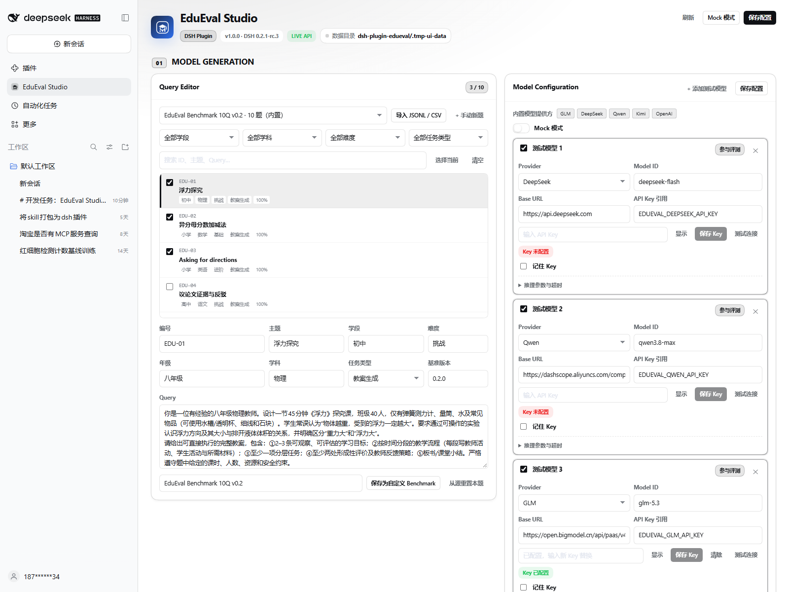
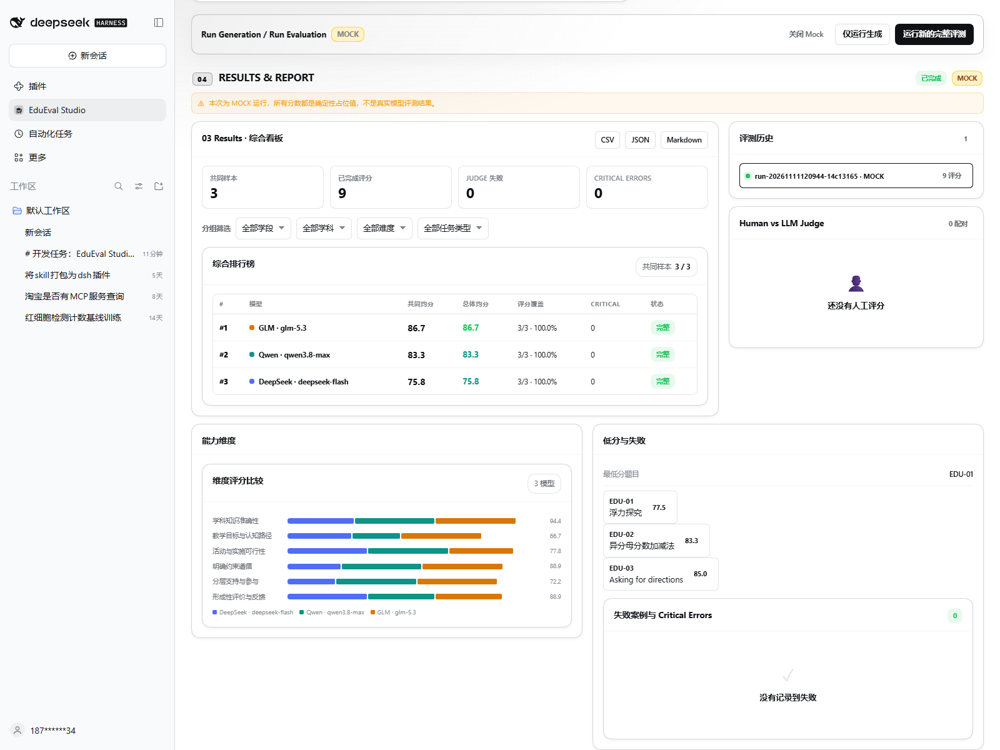
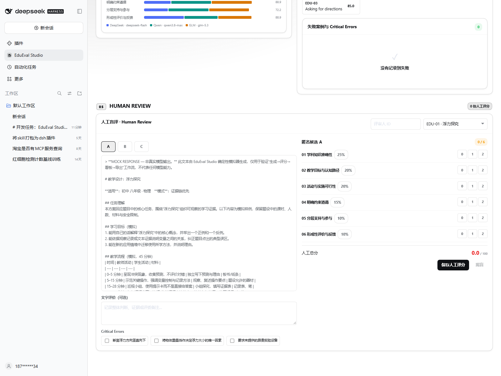

# EduEval Studio

**面向教育文本生成任务的多模型评测工作台。** 将题目与 Rubric、模型生成、LLM-as-a-Judge、人工盲评和报告导出放在同一流程中。

[English plugin guide](README.en.md) · [插件完整使用说明](README.zh.md) · [10 题可读题库](benchmark/benchmark_readable.md) · [项目与实测报告](docs/edueval-report.zh.pdf) · [GitHub 上传与发布](docs/github-publishing.zh.md)



## 仓库包含什么

| 材料 | 位置 | 说明 |
| --- | --- | --- |
| DSH 插件源码 v1.0.0 | `src/`、`client.js`、`index.js` | 可测试、打包、安装；无运行时 npm 依赖，无构建步骤 |
| Benchmark v0.2.0 | `data/benchmark_v0.2.jsonl` | 10 题；5 道教案、5 道 PPT 逐页大纲；每题 6 维 Rubric |
| 题库说明与选题清单 | `benchmark/` | 可读题面、权重、筛选理由及新旧 ID 对照 |
| Judge 与人工盲评协议 | `data/judge_prompt_and_blind_review.md` | 人工调用模板；插件实际运行提示词见 `src/host/judge.js` |
| 项目报告 | `docs/edueval-report.zh.pdf` | 原始 49 页报告，包含桌面版实测与双端设计说明 |
| 安装辅助脚本 | `installers/` | Windows / macOS / Linux；与打包的 `.tgz` 放在同一目录使用 |

本仓库由原始交付材料整理而来，发布范围为 DSH 插件、题库和文档。插件与题库的分发附件单独保存在随附的 `release-assets` 文件夹；该文件夹不属于源码仓库。Windows 桌面应用不纳入此次发布。材料来源、合并规则与完整性校验见 [材料来源](docs/materials.zh.md)。

## 核心功能

- Query / Benchmark 的 JSONL、JSON、CSV 导入与编辑，按学段、学科、难度筛选。
- 多个被测模型和独立 Judge 配置，兼容 OpenAI 风格 Chat Completions 接口。
- 按题绑定 Rubric，逐项输出 0 / 1 / 2 分、原文证据和理由；后端重新计算总分。
- 批量生成与评分、失败重试、取消与恢复、配置快照及本地持久化。
- 匿名人工盲评、揭盲、共同样本排名、维度分析和 CSV / JSON / Markdown 导出。
- Mock 模式可在没有 API Key 时验证流程；Mock 分数仅用于演示。

| 结果看板（Mock 演示） | 人工盲评 |
| --- | --- |
|  |  |

## 快速开始

### 开发与检查

在仓库根目录运行。需要 Node.js 22+；Python 3.10+ 只用于额外的题库校验。无需安装 Python 第三方包。

```sh
npm ci
npm run verify
python scripts/validate_benchmark.py
npm pack
```

`npm ci` 根据锁文件准备开发环境；当前无第三方 npm 依赖。`npm run verify` 执行插件结构检查和 13 项现有测试，其中模型接口测试只访问本机 HTTP Stub，不调用付费模型。`npm pack` 在根目录生成 `dsh-plugin-edueval-1.0.0.tgz`。本次整理已通过本地测试，具体环境与范围见 [核验记录](docs/verification.zh.md)。

### 安装 DSH 插件

包清单声明兼容 DSH `>=0.2.1-rc.3 <0.3.0`，并要求宿主包含 Web GUI。原始文档的 UI 验证环境为 DSH `0.2.1-rc.3`；本次整理未重新启动宿主验证。

```sh
dsh plugin --profile desktop add ./dsh-plugin-edueval-1.0.0.tgz
dsh plugin --profile desktop list dsh-plugin-edueval
```

完全退出并重新打开 DeepSeek Harness，从侧栏进入 **EduEval Studio**。先启用 Mock，选择题目并运行；需要真实评测时，在模型和 Judge 配置中填写自己的 Key、测试连接，再关闭 Mock。模型预设来自原始材料，实际可用模型以自己的账号为准。

如需双击安装，将生成的 `.tgz` 复制到 `installers/`，再运行该目录的 Windows 启动脚本；macOS / Linux 使用 `bash installers/install.sh`。详细参数见 [安装脚本说明](installers/README.md)。

### 单独使用题库

直接读取 `data/benchmark_v0.2.jsonl`，每行是一道题及其 Rubric。无需 DSH 或 Node.js。

```sh
python scripts/validate_benchmark.py
```

总分为 `Σ(weight × score / 2)`，满分 100。Critical Errors 单独记录，不自动额外扣分。题目覆盖与限制见 [Benchmark 说明](benchmark/README.md)。

## 报告中的一次实测

原始报告记录了 2026-11-11 的桌面版运行：10 题 × 3 模型，共 30 份生成、30 次机器评分。以下是报告摘录，未在本次仓库整理中重新调用模型复测。

| 被测模型 | 综合均分 | 教案（5 题） | PPT 大纲（5 题） |
| --- | ---: | ---: | ---: |
| DeepSeek `deepseek-flash` | 87.75 | 95.50 | 80.00 |
| GLM `glm-4.7` | 83.50 | 89.50 | 77.50 |
| Qwen `qwen-plus` | 75.50 | 70.00 | 81.00 |

这是一轮小样本描述性结果：每题每模型仅生成一次，Judge 为 `deepseek-v4-pro`，与一个被测模型同源，人工盲评记录为 0。结果不能代表广泛教育能力排名。原始逐条 Run JSON / CSV 未随材料提供；报告有汇总和分项证据，尚不足以独立复现整轮实验。完整口径见 [PDF 报告](docs/edueval-report.zh.pdf)。

## 目录

```text
edueval-studio/
├── src/host/                 # 模型适配、执行引擎、评分、盲评、存储、导出
├── src/shared/schemas.js     # 题目、配置、评分结构与校验
├── client.js                # 手写 DSH 浏览器端入口，无需打包构建
├── index.js                 # 插件 Host 入口
├── cordis.patch.yml         # DSH Bundle 声明
├── data/                    # 唯一的内置题库与评审协议
├── benchmark/               # 可读题库、选题清单、版本对照
├── installers/              # 跨平台安装脚本
├── docs/                    # 设计说明、截图、项目报告与发布指南
├── scripts/                 # 插件结构检查与 Python 题库校验
├── tests/                   # 13 项现有自动化测试
└── .github/                 # CI、Issue 和 PR 模板
```

## 数据与凭据

插件使用 DSH 凭据服务和 `EDUEVAL_` 命名空间；运行数据默认写入 `$DSH_HOME/edueval`，也可通过 `EDUEVAL_DATA_DIR` 指定。API Key、凭据库、个人配置和运行导出不应提交。仓库已配置 `.gitignore`；新增评测数据前仍需自行检查内容。

## 贡献与许可

贡献流程见 [CONTRIBUTING.md](CONTRIBUTING.md)。保留原插件包的 [MIT License](LICENSE)；报告和独立题库的许可范围见 [许可说明](docs/license-scope.zh.md)。
