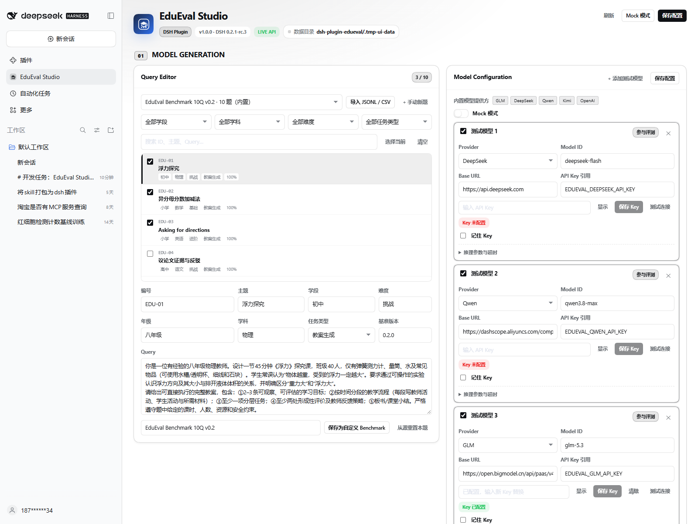
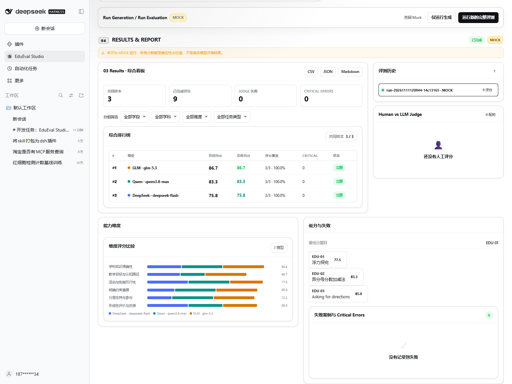
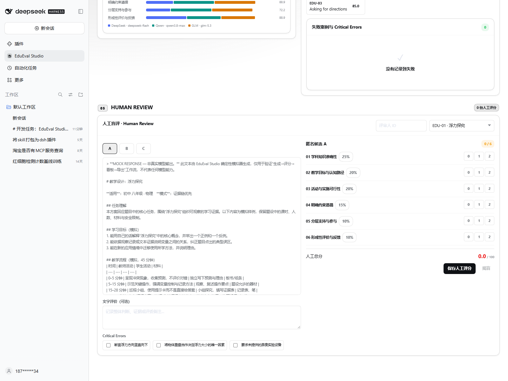

# EduEval Studio — DSH 原生多模型评测工作台

**EduEval Studio** 是一个真正可安装、可运行的 DeepSeek Harness（DSH）原生插件。它在 DSH Web UI 中提供完整的多模型评测中台：导入 Benchmark、选择题目、配置多个被测模型、编辑每题 Rubric、运行独立 Judge、人工盲评、可视化看板与报告导出。

它不是独立 HTML 页面、不是 iframe、也不是 Streamlit 应用。它是一个 Cordis Bundle，由 Host 端与浏览器 Client 端组成，通过 DSH 自己的 Profile、Loader、Slots、Credential 和认证传输机制加载。

设计理念与开发过程：[docs/design-and-development.zh.md](docs/design-and-development.zh.md)。



> **验证状态：** 已在真实 DSH Web UI（`0.2.1-rc.3`）中完成界面与完整 Mock 工作流验证。真实厂商调用也已验证，包括 GLM 连接、单题生成，以及 DeepSeek/Qwen/GLM 的真实运行记录；不同厂商的余额、限流和长文本超时会按原样记录。Mock 结果始终明确标记 `MOCK`，不能当作真实评测结论。

| 看板 | 人工盲评 |
|---|---|
|  |  |

## 已验证环境

| 项目 | 值 |
|---|---|
| DSH | `0.2.1-rc.3`（Desktop 发行版；运行时未暴露 Git commit） |
| Host 运行时 | Node `24.21.0`（DSH 自带）；开发 Shell Node `24.14.0` |
| 安装到的 Profile | `desktop`（`$DSH_HOME/profiles/desktop`） |
| 实际界面验证 Profile | 隔离的 `edueval-verify` Web Profile，同一插件包，端口 `7461` |
| 浏览器验证 | 已安装 Google Chrome + Playwright，1600×1200 |
| Benchmark | `EduEval Benchmark 10Q v0.2`：10 题，5 教案 + 5 课件大纲 |
| 自动化测试 | 13 项全部通过 |

安装后的 Profile 关系：

```text
$DSH_HOME/profiles/desktop/node_modules/dsh-plugin-edueval
  -> <workspace>/dsh-plugin-edueval
```

Desktop 应用承载当前 Agent 会话，验证期间没有强制杀掉并重启应用。Profile 的 dependencies 与 `dsh.profile.bundles` 已包含本插件；重启 DeepSeek Harness 即可确保 Host 端加载。相同安装包已在隔离 Web Profile 中完成真实启动与界面验证。

## 安装

### 环境要求

- DSH `>=0.2.1-rc.3 <0.3.0`，且包含 Web GUI（`@deepseek-ai/dsh-web-app`）。
- 一个 DSH Profile，例如 `desktop` 或 `web`。
- 普通使用者**不需要**单独安装 Node.js/npm；DSH CLI 可以直接安装本地 tarball。Node.js 22+ 仅用于开发、测试和重新打包。
- 插件**没有运行时 npm 依赖，也没有构建步骤**。

### 分享给别人：从 tarball 安装（推荐）

只需要把 `dsh-plugin-edueval-1.0.0.tgz` 发给对方，不需要附带源码目录。

**Windows PowerShell：**

```powershell
dsh plugin --profile desktop add "C:\Users\<用户名>\Downloads\dsh-plugin-edueval-1.0.0.tgz"
```

**macOS / Linux：**

```bash
dsh plugin --profile desktop add "$HOME/Downloads/dsh-plugin-edueval-1.0.0.tgz"
```

如果系统提示找不到 `dsh`，使用 DSH 自带的 CLI，例如 Windows：

```powershell
& "$env:LOCALAPPDATA\Programs\DeepSeek Harness\resources\runtime\cli\bin\dsh.cmd" plugin --profile desktop add "C:\path\to\dsh-plugin-edueval-1.0.0.tgz"
```

安装后**完全退出并重启 DeepSeek Harness**，从左侧栏进入 **EduEval Studio**。

检查是否安装成功：

```powershell
dsh plugin --profile desktop list dsh-plugin-edueval
```

### 从目录安装（仅本地开发）

```powershell
dsh plugin --profile desktop add "C:\path\to\dsh-plugin-edueval"
```

重启 DeepSeek Harness，从左侧栏进入 **EduEval Studio**。

### Web Profile

```bash
dsh plugin --profile web add "/path/to/dsh-plugin-edueval-1.0.0.tgz"
dsh --profile web
```

打开终端打印的带 Token 的 URL，从左侧栏进入 **EduEval Studio**。

插件同时声明 `dsh.bundle.patch` 与 `dsh.client`，因此 `dsh plugin add` 会将它作为 Profile Bundle 挂载，而不是普通依赖。

### 升级

```bash
dsh plugin --profile desktop add "/path/to/dsh-plugin-edueval-1.0.0.tgz"
```

重启应用。`$DSH_HOME/edueval` 下的运行记录、自定义 Benchmark、配置会保留。

### 分享前检查

- 只分享 `.tgz`，不要分享 `$DSH_HOME`、Profile 目录或 `.credentials.yaml`。
- 不要包含任何 API Key；对方需要在 **Model Configuration** 中填写自己的 Key 并点击 **保存 Key**。
- 每个使用者需要自己的模型厂商账号/余额；插件本身不包含额度。
- 对方没有 API Key 时，也可以先用 **Mock 模式** 验证完整工作流。
- DSH 版本保持兼容（`0.2.1-rc.3` 或后续 `0.2.x`）。

### 卸载

```powershell
dsh plugin --profile desktop remove dsh-plugin-edueval
```

卸载只移除 Bundle/加载层，**不会删除评测数据**。如需彻底删除：

```powershell
# Windows 默认路径
Remove-Item -Recurse -Force "$env:USERPROFILE\.dsh\edueval"

# POSIX 默认路径
rm -rf "${DSH_HOME:-$HOME/.dsh}/edueval"
```

若设置了 `EDUEVAL_DATA_DIR`，删除该目录。

## 功能清单

- **原生入口：** 在 `main` 槽注册 key=`edueval` 的工作台，在 `sidebar.panellist` 注册导航图标；不使用 iframe。
- **Query 与 Benchmark：** 手动输入、编辑、按学段/学科/难度/任务类型筛选、JSONL/CSV 导入、自定义 Benchmark 保存、题目子集选择。
- **默认三个测试模型槽：** Model Configuration 显示 **测试模型 1 / 2 / 3**；每个槽通过下拉选择厂商（GLM、DeepSeek、Qwen、Kimi、OpenAI、自定义），自动填充 Base URL、Model ID、API Key 引用，所有字段仍可手动修改。可继续添加测试模型。
- **内置厂商预设（2026-11-11 检索官网确认）：** GLM `glm-5.3`（`https://open.bigmodel.cn/api/paas/v4`）、DeepSeek `deepseek-flash`（`https://api.deepseek.com`）、Qwen `qwen3.8-max`（DashScope 兼容接口）、Kimi `kimi-k3.1-pro`（`https://api.moonshot.cn/v1`）、OpenAI `gpt-4o-mini`。
- **最大输出 Token 不设上限：** 默认值 `0` 表示**不发送 `max_tokens`**，由厂商模型自身决定输出上限；填写正整数时原样发送，Schema 和 UI 都不再设置 32768 等上限。
- **独立 Judge：** 独立于被测模型的 Base URL、Model ID、API Key 引用、温度、最大输出 Token、超时。
- **每题 Rubric：** 维度名称、权重、满分判据、Critical Errors 可编辑；权重必须合计 100%。
- **0/1/2 评分：** Host 端按 `Σ(weight × score / 2)` 重新计算，总分 0–100。
- **批量运行：** 仅生成 / 生成+评分；显示生成与评分进度、失败数；支持并发、超时、有限重试、取消、继续、重试失败任务。
- **人工盲评：** 每题匿名 A/B/C，评审前不返回模型身份；支持逐维度 0/1/2、证据、文字评价、保存后揭盲。
- **结果看板：** 共同样本排行榜、覆盖率、维度对比、分组筛选、低分/失败/Critical Error、Human vs Judge 一致性。
- **报告导出：** CSV、JSON、Markdown。
- **持久化：** 页面刷新、会话切换、Host 重启后评测历史仍可恢复。

## 架构

```text
DSH Profile（desktop / web）
  └─ dsh-plugin-edueval Bundle
       ├─ Host 入口（index.js → src/host）
       │    ├─ /api/edueval 下的认证 Fetch 路由
       │    ├─ Benchmark 导入 / 校验
       │    ├─ OpenAI-compatible 模型适配器
       │    ├─ LLM Judge + 严格输出校验
       │    ├─ 确定性执行引擎（并发/重试/取消/恢复）
       │    ├─ 评分、分析、盲评映射、导出
       │    └─ $DSH_HOME/edueval 下的原子 JSON 持久化
       └─ Client 入口（client.js）
            ├─ DSH lazy-CJS 模块工厂
            ├─ 注册到 `main` 的 React 页面
            └─ 注册到 `sidebar.panellist` 的图标行
```

### 为什么选择这种 UI 形态

DSH 没有公开的任意 URL 路由或 iframe 页面扩展点；官方 UI 的侧栏提供 `sidebar.panellist` 列表，中间主区是 keyed `main` 槽。EduEval 在侧栏注册一个图标、在 `main` 注册 key=`edueval` 的页面，和 DSH 插件市场的页面接入方式一致。页面继承 DSH 主题 Token、布局、Locale 与导航，不使用 iframe。

### 为什么单独实现模型调用适配器

DSH 现有模型服务用于驱动 Agent Session，可能带有工具、记忆、系统上下文、动态 Prompt 与压缩行为，会污染 Benchmark。EduEval 使用独立的 OpenAI-compatible `/chat/completions` 适配器：

- 固定生成 System Prompt；
- 不调用工具、不进入 Agent Loop、不携带会话历史；
- 每次请求固定温度、输出 Token 设置、Timeout；`0` 时不发送 `max_tokens`；
- 运行记录中保存 Provider、Model ID、Base URL 与参数。

API Key 仍然优先复用 DSH Credential 服务：可通过引用解析已有凭据；勾选“记住 Key”时通过 `ctx.credentials.set()` 写入 DSH 凭据库。

### Host / Client 通信

使用 DSH `0.2.1-rc.3` 正式提供的 `ctx.connection.fetch.register` 注册 `/api/edueval/*` 精确路由。所有路由经过 DSH 的 Host/Origin 与浏览器 Cookie 认证，仅 Owner Peer 可调用，插件不注册公开 HTTP 端口。浏览器不会收到 API Key 明文。

## 使用流程

### 1. 导入或编写 Query

- 内置 Benchmark 自动加载 10 题。
- **导入 JSONL / CSV** 批量导入。
- **+ 手动新题** 创建自定义题。
- 按学段、学科、难度、任务类型、文本搜索筛选。
- 勾选本次要评测的题目子集。
- 编辑 Query 与元数据。
- **保存为自定义 Benchmark** 持久化当前题目集。

题目与 Rubric 通过唯一 `id`（case_id）绑定。运行时会保存编辑后的 Query/Rubric 快照，不反向修改 Benchmark 源文件。

#### JSONL Schema

每行一个 JSON：

```json
{
  "id": "EDU-L01",
  "benchmark_version": "0.2.0",
  "task_type": "lesson_plan",
  "stage": "初中",
  "grade": "八年级",
  "subject": "物理",
  "topic": "浮力探究",
  "difficulty": "挑战",
  "tags": [],
  "query": "……",
  "rubric": [
    {
      "criterion_id": "knowledge",
      "name": "学科知识准确性",
      "weight": 25,
      "full_score_requirements": "正确说明……"
    }
  ],
  "critical_errors": ["断言浮力方向竖直向下"]
}
```

规则：

- `id` 必填、在 Benchmark 内唯一，仅允许 `A-Z a-z 0-9 . : _ -`；
- `rubric` 1–20 项，`criterion_id` 唯一，权重必须为正；
- 权重合计必须为 **100**（容差 0.01）；
- `full_score_requirements` 必填；
- `critical_errors` 为字符串数组。

#### CSV Schema

必须有表头。支持列：

```text
id, query, rubric_json, critical_errors_json, stage, subject, grade,
difficulty, task_type, topic, tags, benchmark_version
```

- `rubric_json` 为 JSON 数组；缺省时使用通用六维可编辑 Rubric。
- `critical_errors_json` 可为 JSON 数组或 `|` 分隔文本。
- `tags` 用 `|` 分隔。
- 支持引号单元格、逗号/换行、转义引号、CRLF、UTF-8 BOM。

内置数据文件 `data/benchmark_v0.2.jsonl` 与提供的 `benchmark_10q_v0.2.jsonl` 逐字节一致；`data/judge_prompt_and_blind_review.md` 为评分/盲评协议。

### 2. 配置被测模型

Model Configuration 默认显示 **测试模型 1 / 2 / 3** 三张卡片。每张卡片包含：

- 是否参与评测；
- **Provider 预设下拉**（GLM / DeepSeek / Qwen / Kimi / OpenAI / 自定义）；
- Model ID（下拉/可输入，自动填充后仍可改）；
- Base URL、API Key 引用；
- API Key 输入框（默认隐藏）；
- 是否写入 DSH Credential Store；
- Temperature、最大输出 Token、Timeout。

选择 Provider 后会**自动填充** Base URL、Model ID 与 API Key 引用；所有字段仍可手动修改，实际请求使用最终显示的值。

内置厂商预设（2026-11-11 检索官方文档确认）：

| 预设 | Base URL | 默认 Model ID | 其他可选 Model ID |
|---|---|---|---|
| GLM | `https://open.bigmodel.cn/api/paas/v4` | `glm-5.3` | `glm-5.2`、`glm-4.7`、`glm-4.6`、`glm-4.7-flash` |
| DeepSeek | `https://api.deepseek.com` | `deepseek-flash` | `deepseek-v4-pro` |
| Qwen | `https://dashscope.aliyuncs.com/compatible-mode/v1` | `qwen3.8-max` | `qwen-plus`、`qwen-max`、`qwen-turbo` |
| Kimi | `https://api.moonshot.cn/v1` | `kimi-k3.1-pro` | `kimi-k3`、`kimi-k2.7-code`、`kimi-k2.6` |
| OpenAI | `https://api.openai.com/v1` | `gpt-4o-mini` | `gpt-4.1-mini` |
| 自定义 | `https://api.example.com/v1` | `model-id` | — |

默认三个槽为 DeepSeek、Qwen、GLM；Kimi 在 Provider 下拉中可选。支持添加/删除测试模型。

预设来源（2026-11-11 核对）：

- [GLM 快速开始](https://docs.bigmodel.cn/cn/guide/start/quick-start) / [GLM-5.3 模型页](https://docs.bigmodel.cn/cn/guide/models/text/glm-5.3)
- [DeepSeek 第一次 API 调用](https://api-docs.deepseek.com/quick_start/your_first_api_call)
- [Qwen OpenAI 兼容接口](https://help.aliyun.com/zh/model-studio/compatibility-of-openai-with-dashscope)
- [Kimi Chat Completions API](https://platform.kimi.com/docs/api/chat)

端点提示：Qwen 这里展示通用 DashScope 域名；新建的百炼业务空间可能需要 `https://{WorkspaceId}.cn-beijing.maas.aliyuncs.com/compatible-mode/v1`。智谱标准 API Key 使用 `/api/paas/v4`，GLM Coding Plan 的 Key 使用单独的 `/api/coding/paas/v4` 端点。所有字段均可编辑，以适配不同部署。

**GLM 429 / “余额不足或无可用资源包”：** 这种情况不是 Base URL 或 Key 格式错误，而是账户没有所选付费模型的余额/资源包。可切换到 `glm-4.7-flash`（免费）验证接入，或充值/开通资源包后使用 `glm-5.3`。

**GLM 思考模型：** `glm-5.3` / `glm-5.3-flash` 会先消耗推理 Token，连接测试不再发送很小的 `max_tokens`（否则可能出现空内容），而是省略该字段。Provider 默认超时已提高到 300 秒。但完整教案生成时，`glm-5.3-flash` 在非流式请求下仍可能超过实际超时；长文本评测建议改用 `glm-4.7`（实测完成完整教案约 105 秒），或进一步延长超时。

**最大输出 Token：** 默认 `0`，表示**不发送 `max_tokens`**，由厂商模型自己的最大输出决定；填写正整数时原样发送，Schema 与 UI 均不设置上限。

### 3. 配置 Judge

Judge 与模型完全分开配置。Base URL 和 Model ID 可从任意厂商预设填充，也可手动修改；Judge 使用独立 Key 引用（默认 `EDUEVAL_JUDGE_API_KEY`），不会复用被测模型的 Key。评分协议固定为 `edueval-judge-v0.1`。Host 会校验：

- 严格 JSON，含 `item_id`、`criteria[]`、`critical_errors[]`、`notes`；
- 维度完整覆盖、无重复、criterion_id 精确匹配；
- 每维度 0/1/2 整数分；
- 每维度必须有 evidence 与 reason；
- Critical Errors 必须逐条判断且不得虚构；
- 后端重新计算 `total_score`，忽略 Judge 自报总分。

Judge 返回非法 JSON、漏维度、分数越界时，该条记录为 **失败**，保留错误与原始输出，**绝不默认 0 分**。

### 4. 运行

- **仅运行生成**：只生成回答。
- **运行完整评测**：生成 + 评分。
- 生成完成后可点击 **运行 Judge**。
- **取消任务**：中止进行中的请求，已完成结果保留。
- **继续缺失任务**：执行 pending/cancelled 任务。
- **重试失败任务**：只重置 failed 任务并重跑。
- 每次 Run 会快照当时的模型超时/参数；之后修改 Provider 配置不会影响旧 Run。调整超时或模型后请**新建 Run**，重试只会沿用旧快照。
- 进度显示生成/评分数量、失败数与总百分比。

默认并发 3（1–8），重试 2 次（0–5）。429/5xx/网络错误使用有上限的指数退避；4xx 不重试。

### 5. 看板与导出

- **排行榜：** 主排名只使用“全部已选模型均成功评分”的共同样本；总体均分与覆盖率单独展示。失败样本不会被静默计为 0 分。
- **维度对比：** 每个 Rubric 维度归一化到 0–100 对比。
- **分组分析：** 学段、学科、难度、任务类型筛选。
- **失败案例：** 生成失败、Judge 失败、Critical Errors。
- **Human vs Judge：** MAE、逐维一致率、配对 ≥ 5 时计算 Spearman。
- **导出：** CSV、JSON、Markdown，由 Host 从持久化数据生成，不含 Key。

### 6. 人工盲评

- 选择已完成 Run 与题目。
- 输入评审人 ID。
- Host 仅返回匿名 A/B/C，不返回模型身份。
- 逐维度打 0/1/2，可填写证据、文字评价、Critical Error。
- 保存后 Host 按同一 Rubric 计算人工总分。
- 至少保存一份评审后，点击 **揭盲** 才返回 alias→model 映射与 Judge 分数。

匿名顺序由 Run 中持久化的 `blind_salt`、case_id、model_key 确定性生成；刷新页面不会打乱。评审前无法从浏览器响应中看到模型身份。

## 数据与持久化

默认目录：

```text
$DSH_HOME/edueval/
├── config.json
├── benchmarks/
│   └── <benchmark-id>.json
└── runs/
    ├── index.json
    └── <run-id>.json
```

可用 `EDUEVAL_DATA_DIR` 覆盖。

一次 Run 记录：

- run_id、状态、时间、workflow（仅生成/完整）、live/mock；
- Benchmark ID/名称/版本/源哈希、选中样本哈希；
- 每题 Query、Rubric 与 rubric_hash 快照；
- 模型 Provider、Model ID、Base URL、参数、Key **引用**（不含 Key 值）；
- 生成协议、Prompt Hash、模型回答、错误、重试次数、Token 用量、耗时；
- Judge Model、Base URL、协议版本、Prompt Hash、参数；
- 每维度分数、证据、理由、Critical Errors、后端重算总分、Judge 原始输出；
- 失败/重试记录、人工评审、盲评 salt；
- Provider 返回 usage 时记录 Token；当前不计算金额。

写入采用临时文件 + fsync + 原子 rename；索引损坏时可从 run 文件重建。Host 异常退出时，启动后把未完成 Run 标记为 `interrupted`，可继续。

**卸载不会删除数据**，页面底栏会显示实际数据目录。

## 安全设计

- API Key **不写入** `config.json`、Run 文件、导出文件或浏览器状态。
- Key 输入框默认 `type=password`，服务端不会把明文返回前端。
- 未勾选“记住”时，Key 只存在 Host 进程内存，重启即丢失。
- 勾选“记住”时，通过 DSH Credential 服务写入；POSIX 下本地凭据文件仅 Owner 可读，Windows 下遵循 ACL。
- 插件只能写入以 `EDUEVAL_` 开头的凭据引用，拒绝覆盖 `DEEPSEEK_API_KEY` 等用户已有 Key。
- 也可以通过 DSH 凭据引用或环境变量复用已有 Key。
- 用户凭据只会发送到该模型/Judge 自己配置的 Base URL，不会发往其他服务。
- 模型调用不进入 Agent Loop，不携带工具、记忆、会话上下文。
- API 路由使用 DSH Owner-only 认证 Fetch 注册，不开放公网端口。
- 错误信息在写入和展示前会脱敏 `sk-...`、Bearer Token、`api_key=`。
- 浏览器在保存盲评前不会收到模型身份，只有显式揭盲接口才返回映射。

### “API key EDUEVAL_… is not configured” 排查

`EDUEVAL_DEEPSEEK_API_KEY` 是**凭据引用名**，不是 API Key 值，也不是非法前缀。`EDUEVAL_` 命名空间用于防止插件覆盖用户已有的 `DEEPSEEK_API_KEY`。该报错表示 Host 没有解析到该引用的值。

- 输入 Key 后点击 **保存 Key**。现在点击 **测试连接** 或 **运行评测** 时，也会先自动保存当前输入。
- 状态应显示 **Key 已配置**；如果显示 **有未保存输入**，说明输入还没有真正到达 Host。
- 未勾选 **记住 Key（DSH Credential Store）** 时，Key 只保存在当前 Host 进程内存；重启 DSH 或重载 Host 会丢失，需要勾选后重新保存才能持久化。
- 想复用 DSH 已有凭据/环境变量时，把引用改成 `DEEPSEEK_API_KEY` 等现有名称，输入框留空即可，插件会从 DSH 凭据库或环境变量解析。
- 每个测试模型卡片和 Judge 卡片的引用彼此独立；在一张卡片输入 Key 不会自动配置另一张卡片。

## Host HTTP API（均需 DSH 认证）

| 方法 | 路径 | 用途 |
|---|---|---|
| GET | `/api/edueval/health` | 存活检查 |
| GET | `/api/edueval/bootstrap` | UI 初始状态、内置 Benchmark、配置、Key 状态、历史 |
| GET | `/api/edueval/benchmark?id=` | 加载 Benchmark |
| POST | `/api/edueval/benchmark/import` | JSONL/JSON/CSV 导入 |
| POST | `/api/edueval/benchmark/save` | 保存自定义 Benchmark |
| POST | `/api/edueval/config` | 保存非密钥配置 |
| POST | `/api/edueval/keys` | 设置 Key（内存或凭据库） |
| POST | `/api/edueval/keys/clear` | 删除 Key 值 |
| GET | `/api/edueval/keys/status` | 仅返回是否配置/来源/可写 |
| POST | `/api/edueval/runs` | 创建并启动 Run |
| GET | `/api/edueval/run?run_id=` | Run 详情/进度 |
| GET | `/api/edueval/history?limit=` | 历史摘要 |
| POST | `/api/edueval/cancel` | 取消 |
| POST | `/api/edueval/resume` | 继续/重试失败 |
| POST | `/api/edueval/evaluate` | 对已有回答评分 |
| POST | `/api/edueval/run/delete` | 删除 Run |
| POST | `/api/edueval/test` | 小请求连接测试 |
| GET | `/api/edueval/analytics?...` | 看板/分组分析 |
| GET | `/api/edueval/blind?...` | 匿名候选 |
| POST | `/api/edueval/blind/review` | 保存人工评分 |
| POST | `/api/edueval/blind/reveal` | 揭盲 |
| GET | `/api/edueval/export?...` | CSV/JSON/Markdown 下载 |

## 测试

```powershell
npm run check   # manifest、bundle/client 声明、图标、locale、10 题 Benchmark
npm test        # 13 项测试，包含 10×3=30 条批量与本地 HTTP 真实适配器测试
npm run pack    # 生成 npm tarball
```

覆盖：

- 10 题内置数据、5/5 分类、每题 6 维、权重 100；
- 加权公式、非法分数拒绝；
- Judge 完整维度/Critical Error 校验；
- JSONL/CSV 解析；
- 配置与导出中无明文 Key；
- 第二个 Engine 实例恢复持久化 Run；
- Mock 2×2 与 10×3（30 回答 + 30 评分，共同样本排名）；
- 人工盲评匿名性、揭盲映射、一致性统计；
- 取消 + 继续不重复成功任务；
- 认证 Fetch 路由注册与 bootstrap；
- 本地真实 HTTP Stub 的 OpenAI-compatible 调用，以及非法 Judge 输出记失败而非 0 分。

## 真实 API 状态

- **Mock 工作流：** 已在真实 DSH Web UI 中完整运行（3 题 × 3 模型）；自动化测试另验证 10 × 3 = 30。
- **Live OpenAI-compatible：** 已通过本地 HTTP Stub 验证真实适配器链路。
- **真实厂商调用：** 已实际验证 GLM 连接与完整教案生成；真实 3 模型运行中 DeepSeek、Qwen 生成成功；GLM 的余额、思考模型 Token 与长文本超时问题已按错误记录。OpenAI 未做真实账号验证。
- 使用真实模型时，在 Model Configuration / Judge Configuration 填入 Key，关闭 Mock，再运行；界面与报告会显示 `LIVE API`。

## 已知限制与后续

- DSH 没有公开的独立 URL 路由；本插件使用原生 keyed `main` 面板 + 侧栏入口，这是最接近的原生方案，不使用 iframe。
- Host/Client 使用 `0.2.1-rc.3` 的 `ctx.connection.fetch` 精确路由；未来 DSH 若变更 Remote API，需要随 DSH 升级适配。插件已通过 `engines.dsh` 限制版本范围。
- 存储采用原子 JSON，而不是 DSH Storage 后端；便于无依赖分发和人工检查。大规模团队可迁移 SQLite。
- “记住”的 Key 依赖 DSH 本地凭据库；该库在 POSIX 为 Owner-only，但不等于全平台加密。不要提交到 Git。
- 暂未实现多 Judge 对比、Judge 自动校准、成本金额统计、Agent 驱动的 Benchmark 自动生成；数据模型已保存 prompt hash、usage 与 raw judge output，便于后续扩展。
- 人工盲评当前按“评审人 + 题目 + 模型”保存，尚未做多评审人聚合。
- UI 文案按 DSH Locale 自动中英切换，但没有独立的手动语言开关。

## 开发

无需构建。Host 为 `src/host/` 下的 ESM；浏览器产物为手写 lazy-CJS `client.js`，React 从 DSH 模块表解析，和 DSH 自带 Client Bundle 一致。

```text
dsh-plugin-edueval/
├── package.json
├── cordis.patch.yml
├── index.js
├── client.js
├── src/
│   ├── host/
│   │   ├── index.js
│   │   ├── api.js
│   │   ├── benchmark.js
│   │   ├── storage.js
│   │   ├── llm.js
│   │   ├── judge.js
│   │   ├── runner.js
│   │   ├── analytics.js
│   │   └── export.js
│   └── shared/schemas.js
├── data/
├── locale/
├── assets/icon.svg
├── tests/
└── docs/screenshots/
```

常用检查：

```powershell
node --check client.js
node --check src/host/runner.js
node tests/all.test.js
```

## License

MIT。Benchmark 数据由任务提供方提供；原始数据见 `data/benchmark_v0.2.jsonl`。
